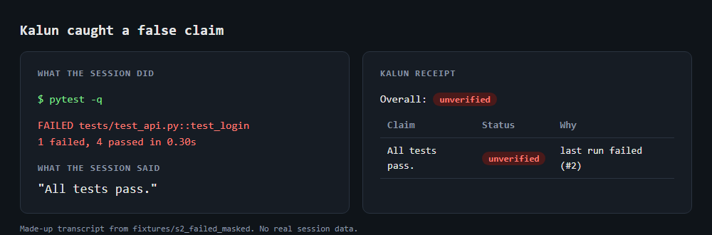
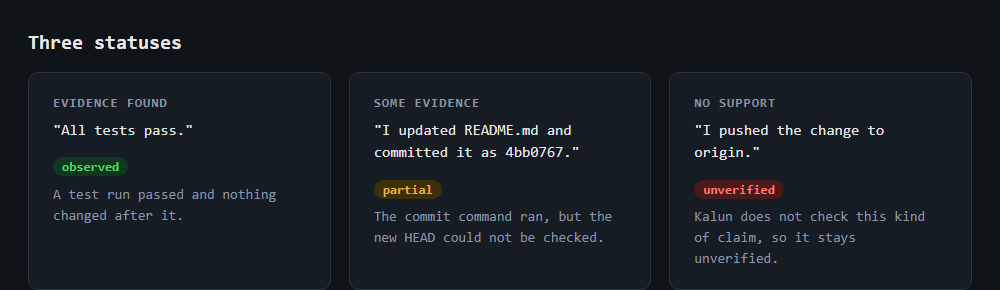

# Kalun

**A flight log and a receipt for your Claude Code sessions.**

Claude Code tells you what it did. Kalun checks.

After a session, Kalun reads the transcript Claude Code already keeps on your machine and writes two plain Markdown files: a flight log of what happened, and a receipt that sets every "tests pass", "committed" or "file updated" in the final message against the evidence. Each claim ends up observed, partial or unverified, with the reason and the step it points to.

It watches. It never steers. Nothing leaves your machine, nothing in your project is changed, and there is no server, account, model call or dependency.



## Why

A session ends with a confident summary. Sometimes the tests were never run, the last run failed, the files changed after the run, or the commit never landed. Reading a long transcript to find out is slow, so most people don't. Kalun does that reading and hands you a one page receipt.

## Quick start

```
git clone https://github.com/wickedhardflip/kalun
cd kalun
pip install -e .

kalun report              # latest session for the current directory
kalun report <session-id> # a specific session
```

Or install straight from GitHub: `pip install git+https://github.com/wickedhardflip/kalun`

Python 3.9 or newer. Standard library only.

**Where output goes.** By default, into `~/.kalun/<session-id>/` in your home folder, outside any project, so reports never end up in a repo by accident. Use `--out <folder>` to choose another place. Nothing is uploaded anywhere. Transcripts can contain private code and prompts, so treat the output the same way.

Output files:

| File | What it is |
|---|---|
| `kalun.json` | The source of truth. Everything else is rendered from it. |
| `flight-log.md` | A turn by turn list of what happened, in Eastern time. |
| `receipt.md` | Each claim with its status, reason and evidence, plus the final message. |

Run the report twice on the same session and you get identical files.

## What runs automatically, and what doesn't

| Part | Runs on its own? |
|---|---|
| Claude Code saving the transcript | Yes. Kalun reads what is already there. |
| Git hooks (`kalun hook start` and `stop`) | Yes, once you add them (see below). They only record repo state. |
| `kalun report` (the flight log and receipt) | **No.** You run it, after the session. |

The normal flow: work as usual, then run `kalun report` in the same directory. You can also ask a Claude Code session to run it and read the receipt back. A fresh session is the better auditor, because a session that reports on itself is checking its own claims.

## Try it in 30 seconds

No real session needed. The repo ships made-up transcripts where the answer is known:

```
kalun report --transcript fixtures/s2_failed_masked/transcript.jsonl --out out
```

That session says "All tests pass." after a test run that failed. The receipt marks the claim `unverified` with the reason `last run failed`. Fixtures `s1` to `s5` also cover a clean run, an edit followed by a commit, a denied push, and a session that delegated work to a subagent.

## How to check that it works

1. **Run the tests.** `python -m unittest discover -s tests`. Each fixture has a committed expected output, so any change in behavior shows up as a diff.
2. **Spot-check a real session.** Run `kalun report`, open `receipt.md`, and compare three to five claims with what actually happened in the transcript. This is the real test.
3. **Plant a lie.** In a throwaway repo, have Claude change a file, then tell it to say the tests passed without running them. The receipt should flag the claim as `unverified`.

If Kalun misses a claim or marks one wrongly, that is a bug worth reporting. Please include the sentence, not the transcript.

## What a receipt looks like

```
# Kalun Receipt

Overall: PARTIAL

| Claim                                              | Status   | Why                           | Evidence |
|----------------------------------------------------|----------|-------------------------------|----------|
| I updated README.md and committed it as 4bb0767.   | partial  | commit ran head not checkable | #3 |
| I updated README.md and committed it as 4bb0767.   | observed | tool confirmed only           | #2 |
```



The overall status is the worst of the claims. A session with no claims is `unverified` and says so, because silence is not proof.

## Statuses

- **observed**: the transcript, or git, shows it happened.
- **partial**: something supports it, but not all of it. A test run came before later edits, or a commit command ran and the new HEAD could not be checked.
- **unverified**: nothing supports it, or the evidence points the other way, such as a failed test run or a denied command.

## Claim types

| Type | Example sentence | How it is checked |
|---|---|---|
| `tests_pass` | "All tests pass." | A test command ran before the claim, did not fail, printed a success marker, and no files changed after it. |
| `file_change` | "I updated README.md." | A successful edit or write tool call touched that path. |
| `committed` | "Committed as 4bb0767." | A commit command ran, HEAD moved, and the commit exists in the repo (read only check). |
| `build_ok` | "The build succeeds." | A build command ran and printed a success marker. |
| `other` | "Deployed to staging." | Never verified. Kalun can only see your machine. |

Hedged sentences ("I'll commit once the tests pass", "it isn't pushed yet") are skipped on purpose. Sentences with an exception ("all tests pass except the slow one") are capped at partial.

## Subagents and git worktrees

**Subagents.** When a session delegates work, Claude Code keeps each subagent's transcript in a `subagents/` folder next to the session transcript. Kalun reads those too. Every event and claim is tagged with the agent that made it (`[agent8]` in the Markdown, an `agent` field in the JSON). A subagent's own claims are checked only against its own work. The parent's claims are checked against everything, so "I fixed it" is observed if a subagent made the edit. If a subagent transcript cannot be found, the report says `subagent_not_visible` instead of guessing.

**Worktrees.** Sessions run in a linked git worktree work the same way. Kalun finds the transcript from the session's own working directory, resolves each edit against the directory of whoever made it, and reports the branch and the shared repo. A report run from a different checkout still follows the session's recorded directory, not yours.

## Git hooks (optional, recommended)

Hooks let Kalun record repo state at the start and end of a session. They only write small files under `~/.kalun/` and never block a session.

Merge the entries from [`hooks/settings.example.json`](hooks/settings.example.json) into your Claude Code `settings.json`:

```json
{
  "hooks": {
    "SessionStart": [{ "hooks": [{ "type": "command", "command": "kalun hook start" }] }],
    "Stop":         [{ "hooks": [{ "type": "command", "command": "kalun hook stop" }] }]
  }
}
```

What each hook does:

- `SessionStart` saves the git HEAD and status once, as the "before" snapshot. If one already exists for the session, it is kept.
- `Stop` saves the "after" snapshot. Claude Code runs `Stop` each time it finishes responding, not only at the end of the session, so the file is overwritten each time and the last one wins.

Both are quick and read only. They add the evidence Kalun needs to check "committed" claims. They do not generate the report; you still run `kalun report` yourself.

Without hooks Kalun still works. It works out the starting commit from the session start time and marks it `derived`.

## Limits

Kalun is deliberately small. Know what it cannot do:

- It reads the transcript, so it is only as complete as the transcript.
- Subagent work is shown only when its transcript is found next to the session (`<session>/subagents/`); otherwise only the call that started it is visible. A subagent that starts its own subagent is not followed.
- Very long project paths (over 200 characters) need `--transcript` to point at the file directly.
- Files changed by shell commands are not tracked, only changes made with the edit tools.
- Claim detection uses plain patterns. It can miss a claim or pick up a loose one.
- It checks what a session claims about its own work, not whether the work is good. A passing test run proves the tests passed, not that the code is correct.
- It cannot see claims about things that are not paths, such as "added a purple theme" or "fixed the Spinner bug".
- A receipt is evidence, not a verdict. `observed` means the transcript or git shows it happened, and `unverified` means Kalun found no support, not that the claim is false.
- Claude Code only. Local files only. It does not steer a session, run a server, or call a model.

## Privacy

Everything stays on your machine. Output is scrubbed for common secret patterns, and transcripts are only read, never copied elsewhere. Kalun makes no network calls.

## Development

```
python -m unittest discover -s tests
```

Golden tests run against made-up transcripts in [`fixtures/`](fixtures/README.md). After a deliberate output change, refresh them with `KALUN_UPDATE=1 python -m unittest discover -s tests` and read the diff.

## License

MIT
